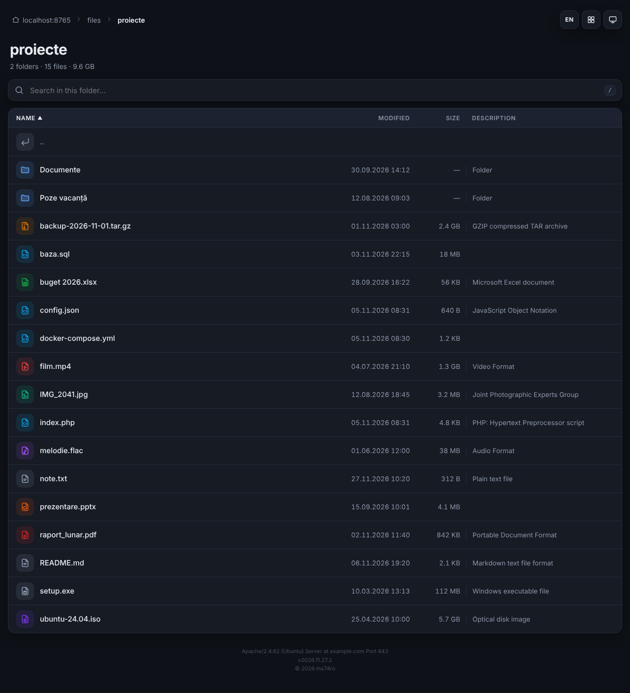
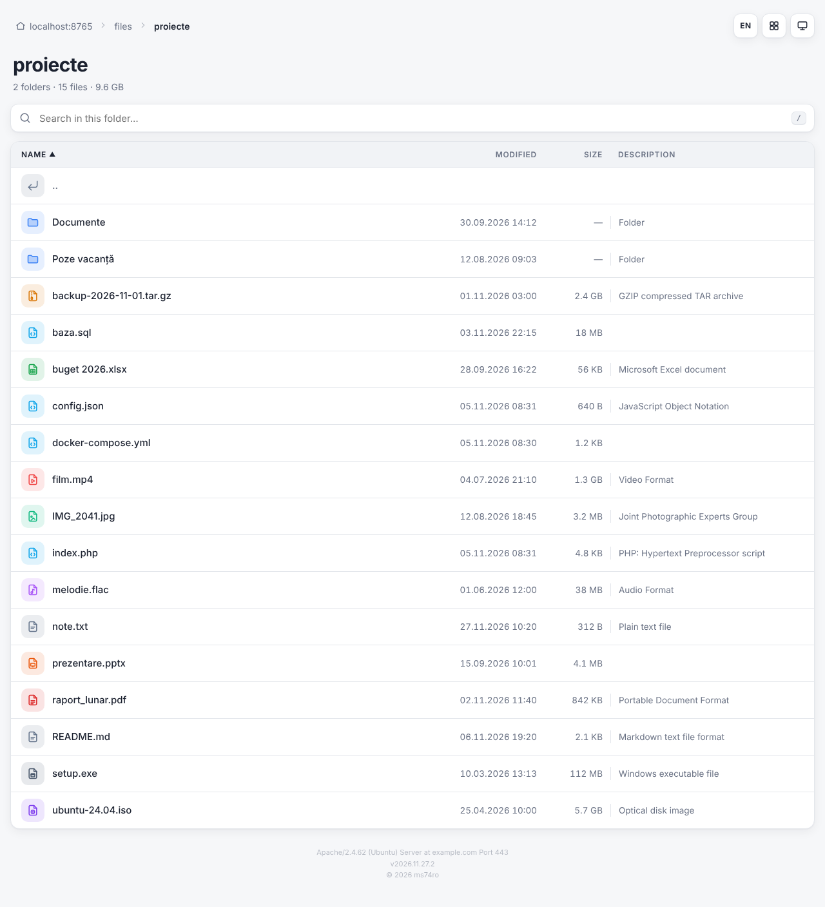

# Index of – Modern Look

🇬🇧 English · [🇷🇴 Română](README.ro.md)

A modern replacement for Apache's plain "Index of" page. It keeps using `mod_autoindex`, so there is
nothing to install on the server besides a few static files: Apache still generates the listing, and a
small script turns it into a clean list with file-type icons, breadcrumbs, instant search, sorting,
a description column and a light / dark theme. It is switched on from a `.htaccess` file, in exactly the
folders where you want it.

## Screenshots





## Features

- Colored icons per file type (folders, images, video, audio, archives, code, PDF, Office, disk images, fonts, databases…)
- Breadcrumb navigation, number of folders / files and total size
- Instant search: `/` focuses the search box, `Enter` opens the first match, `Esc` clears it
- Sorting by name, date, size or description; folders always come first
- **Description** column after the size (from Apache `AddDescription`); folders simply show "Folder"
- Light, dark or automatic (system) theme and list / grid view, both remembered in the browser
- Interface in **English (default)** and Romanian: the **EN / RO** button in the top bar switches it and the choice is remembered. Adding a language is one block in `script.js`
- Responsive layout (the description and date columns are hidden on narrow screens)
- Without JavaScript the original Apache table is still shown, styled
- Version and copyright shown discreetly in the footer, above the Apache server signature
- Works behind a reverse proxy (all links are root-relative)

## How it works

`.htaccess` tells Apache to wrap its directory listing with two files, using `HeaderName` and `ReadmeName`:

- `header.html` opens the page (head, top bar, search box, column titles) and loads `style.css`;
- Apache inserts its own listing as an HTML table (`IndexOptions HTMLTable`);
- `footer.html` closes the page and loads `script.js`, which reads that table, builds the new list and hides the table.

The theme files are served from `/.index_of/`. Because they are referenced by URL, the folder has to be reachable
from every site that should use the theme: put it in each DocumentRoot, or publish it once with an `Alias`
(recommended when you have several sites or virtual hosts).

## Repository layout

```
www/                         copy into your web root
├── .htaccess                enables the listing and the theme
└── .index_of/
    ├── header.html          start of the page (head, top bar, search, columns)
    ├── footer.html          end of the page, version + copyright (footInfo)
    ├── style.css            layout, light / dark theme
    └── script.js            reads Apache's table and builds the list
apache/
└── index-of.conf            Alias /.index_of, one copy for all virtual hosts
docs/                        screenshots
```

## Requirements

- Apache 2.4 with `mod_autoindex` and `mod_alias`. Both are enabled by default on Debian / Ubuntu and in the official `php:*-apache` image.
- `.htaccess` files must be allowed: `AllowOverride` has to include at least `Indexes Options FileInfo`
  (plus `AuthConfig` if you use `Require ip`), or simply `AllowOverride All`.
  Debian's default `apache2.conf` sets `AllowOverride None` for `/var/www/`.

## Installation

### Option A: Apache installed on the host (Debian / Ubuntu)

1. **Copy the theme** into the web root:

   ```bash
   sudo cp -r www/.index_of /var/www/html/
   ```

2. **Publish it for all sites (recommended).** Edit the path in `apache/index-of.conf` if your theme folder is not
   `/var/www/html/.index_of`, then enable it:

   ```bash
   sudo cp apache/index-of.conf /etc/apache2/conf-available/index-of.conf
   sudo a2enconf index-of
   sudo apache2ctl configtest && sudo systemctl reload apache2
   ```

   With a single site whose DocumentRoot already contains `.index_of/`, you can skip this step.
   On RHEL / Fedora place the file in `/etc/httpd/conf.d/` instead and reload `httpd`.

3. **Allow `.htaccess`** for your site, in its `<VirtualHost>` or in `apache2.conf`:

   ```apache
   <Directory /var/www/html>
       AllowOverride All
   </Directory>
   ```

4. **Switch the theme on** by copying `www/.htaccess` into the folder you want listed. In the web root it applies to
   every folder below it (see [Per-folder control](#per-folder-control-and-security)):

   ```bash
   sudo cp www/.htaccess /var/www/html/.htaccess
   ```

5. **Check:** `https://your-domain/.index_of/style.css` must return the CSS. After that, any folder without an
   `index.html` / `index.php` shows the new listing. Press Ctrl+F5 after updates to bypass the browser cache.

### Option B: Apache in Docker (`php:*-apache`)

The listing is generated by the Apache inside the container, so the theme has to be visible *there*.

1. **Put the theme in the folder you mount as the web root**, for example host `./www` → `/var/www/html` in the container:

   ```
   www/.htaccess
   www/.index_of/…
   ```

2. **Load `index-of.conf` into the container.** Check that the path inside it matches the container path of the theme
   (`/var/www/html/.index_of` by default). Choose one way:

   - *Baked into the image* (needs a rebuild whenever the file changes). Put the file next to your `Dockerfile`:

     ```dockerfile
     COPY index-of.conf /etc/apache2/conf-enabled/index-of.conf
     ```

     then run `docker compose up -d --build`.

   - *Bind mount* (a restart is enough). In `docker-compose.yml`:

     ```yaml
     services:
       apache:
         volumes:
           - ./www:/var/www/html
           - ./apache/index-of.conf:/etc/apache2/conf-enabled/index-of.conf:ro
     ```

     then run `docker compose up -d` (or `docker compose restart apache` after editing the file).

3. **Allow `.htaccess`.** The stock image uses `AllowOverride None` for `/var/www/`, so enable it in the `<Directory>`
   block of your site or virtual host (same snippet as in Option A, step 3).

4. **Check** `https://your-domain/.index_of/style.css`. `.htaccess` and the files in `.index_of/` are bind-mounted
   content and apply immediately; only changes to `index-of.conf` need a restart or a rebuild.

Behind a reverse proxy (Nginx Proxy Manager, Traefik, …) nothing else is required: it only forwards requests.

## Configuration (`.htaccess`)

| Directive | Why it is needed |
| --- | --- |
| `Options +Indexes` | Turns directory listing on |
| `IndexOptions … HTMLTable` | Apache outputs the table the script reads |
| `IndexOptions … SuppressHTMLPreamble` | `header.html` already contains the full page (`<html>`, `<head>`) |
| `IndexOptions … SuppressIcon` | Drops the old icons from `/icons/` |
| `HeaderName` / `ReadmeName` | URLs (not disk paths) of `header.html` / `footer.html`, resolved through the `Alias` |
| `IndexIgnore` | Hides technical files from the listing |

**Limit access by IP.** Uncomment and edit the `Require ip` line at the top of `.htaccess`:

```apache
Require ip 192.168.1.0/24 10.0.0.5
```

**File descriptions (`AddDescription`).** Apache looks for the text *anywhere* in the file name, the match is
case-sensitive, and the first matching rule wins. Specific extensions therefore come before short ones:
`.tar.gz` before `.gz`, `.json` before `.js`, `.phps` before `.php`, `.mds` before `.md`. Add uppercase variants for
photos and videos from phones (`.JPG`, `.MP4`). Folders need no rule: the script shows "Folder" automatically.

## Per-folder control and security

`.htaccess` in the web root makes **every** folder without an `index.html` / `index.php` browsable on all sites,
including folders such as `includes/`, `config/`, `uploads/` or `vendor/`. Folders that have an index file show it
as usual. Everything is controlled with one line in the `.htaccess` of the folder concerned; settings are inherited
by subfolders:

| You want | Put in that folder's `.htaccess` |
| --- | --- |
| Block listing (`includes/`, `config/`, `uploads/`, `vendor/`, backups) | `Options -Indexes` |
| Listing only where you choose (web root with `Options -Indexes`) | `Options +Indexes` |
| Listing in a folder that has an `index.html` | `DirectoryIndex disabled` |

`IndexIgnore` only hides names from the listing; it does not block direct access to those files. The `Alias` exposes
only the static theme files.

## Customizing

| What | Where |
| --- | --- |
| Interface language and texts (column titles, search placeholder, "Folder", counters) | `LANGS` in `script.js`. The first-visit language is `DEFAULT_LANG` (`'en'` or `'ro'`); to add a language, copy one block and translate it |
| Colors, icon colors, maximum width (`.shell`), columns | `style.css` |
| File types and their icons | `TYPES` and `ICONS` in `script.js` |
| Version and copyright | `footInfo` in `footer.html` |

## Troubleshooting

| Symptom | Cause | Fix |
| --- | --- | --- |
| Works on the IP address, the domain shows the plain listing | The domain has another DocumentRoot, `/.index_of/` does not exist there | Publish the theme with the global `Alias` (`apache/index-of.conf`) |
| `/.index_of/style.css` returns 404 | The `Alias` path is not the real one (inside the container) | `docker exec <container> ls /var/www/html/.index_of`, then fix the path |
| 500 error after adding `.htaccess` | `AllowOverride` does not allow a directive used in it | `AllowOverride All`, or at least `Indexes Options FileInfo` (+ `AuthConfig` for `Require`) |
| CSS loads but the listing is still the old one | The site has `AllowOverride None`, so `.htaccess` is ignored | Allow `.htaccess` as described above |
| Styled page without search or icons | `script.js` is not loading | Open `/.index_of/script.js` in the browser |
| Theme not updated after a change | Browser cache | Ctrl+F5 |
| A folder does not show the listing | It has an `index.html` / `index.php` | Expected; otherwise add `DirectoryIndex disabled` |
| Wrong description for a file | A shorter rule matches first | Move the specific rule above it |
| No description for `.JPG` / `.MP4` | Matching is case-sensitive | Add the uppercase extension |

## Versioning

Date-based: `YYYY.MM.DD.counter` (for example `2026.11.27.1` is the first release of 27 Nov 2026). The value is
shown in the footer (`www/.index_of/footer.html`) and equals the git tag (`v2026.11.27.1`). See [CHANGELOG.md](CHANGELOG.md).

## License

[MIT](LICENSE) © 2026 ms74ro. A Romanian translation, for information only, is in [LICENTA.md](LICENTA.md).
