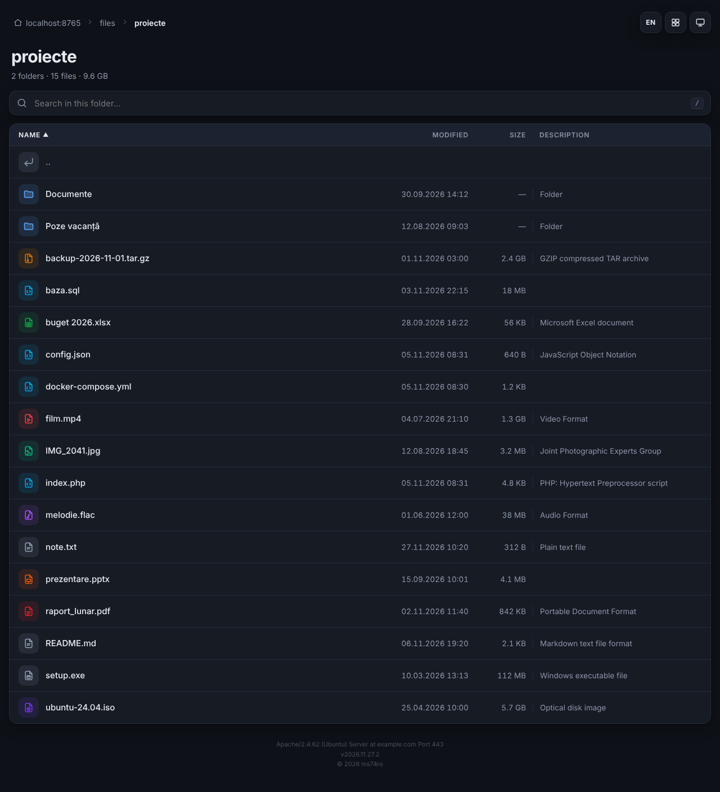
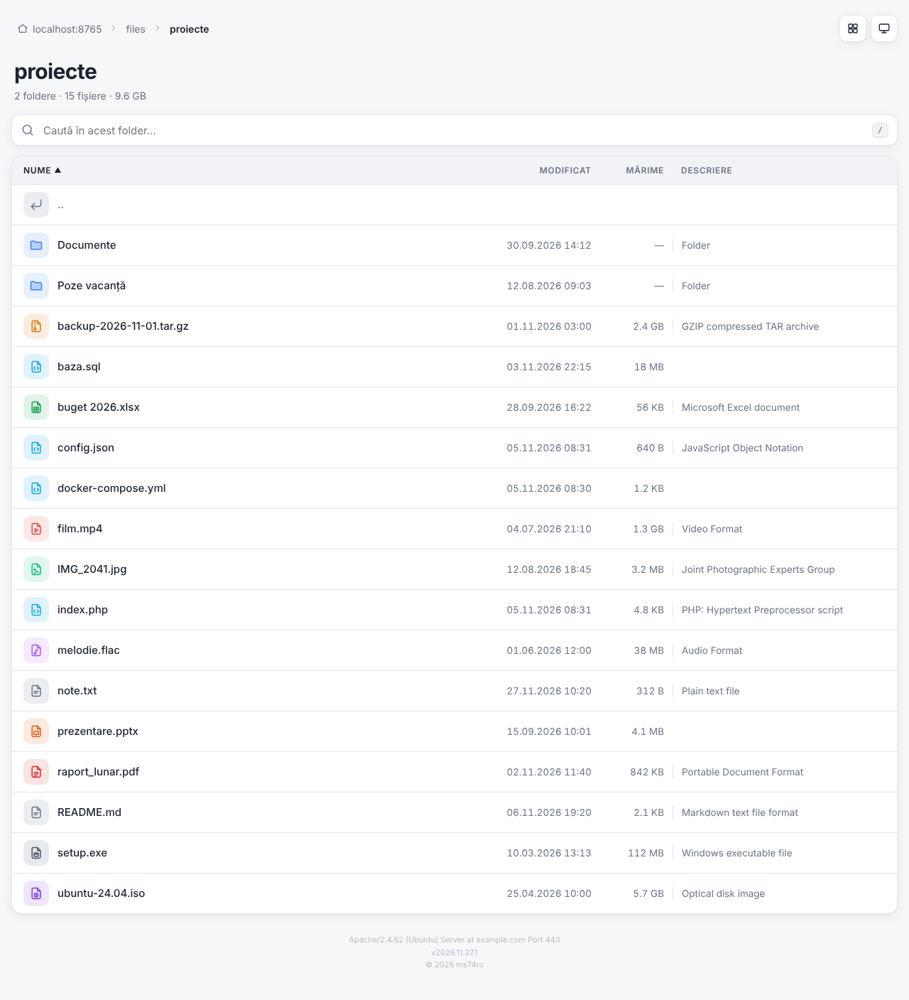

# Index of – Modern Look

[🇬🇧 English](README.md) · 🇷🇴 Română

Un înlocuitor modern pentru pagina simplă „Index of” din Apache. Folosește în continuare `mod_autoindex`, deci
nu instalezi nimic pe server în afară de câteva fișiere statice: Apache generează în continuare listarea, iar un
script mic o transformă într-o listă curată, cu iconuri pe tip de fișier, breadcrumbs, căutare instant, sortare,
coloană de descriere și temă luminoasă / întunecată. Se activează dintr-un fișier `.htaccess`, exact în folderele
unde vrei.

## Capturi de ecran





## Funcții

- Iconuri colorate pe tip de fișier (foldere, imagini, video, audio, arhive, cod, PDF, Office, imagini de disc, fonturi, baze de date…)
- Navigare prin breadcrumbs, numărul de foldere / fișiere și mărimea totală
- Căutare instant: `/` mută cursorul în căsuța de căutare, `Enter` deschide primul rezultat, `Esc` o golește
- Sortare după nume, dată, mărime sau descriere; folderele sunt mereu primele
- Coloana **Descriere** după mărime (din `AddDescription` din Apache); folderele afișează simplu „Folder”
- Temă luminoasă, întunecată sau automată (după sistem) și vizualizare listă / grilă, ambele reținute în browser
- Interfață în **engleză (implicit)** și română: butonul **EN / RO** din bara de sus o schimbă, iar alegerea este reținută. Adăugarea unei limbi înseamnă un bloc în `script.js`
- Aspect adaptat la ecrane mici (coloanele Descriere și Dată se ascund pe ecrane înguste)
- Fără JavaScript rămâne vizibil tabelul original Apache, stilizat
- Versiunea și copyright-ul apar discret în subsol
- Funcționează în spatele unui reverse proxy (toate legăturile pornesc de la rădăcină)

## Cum funcționează

`.htaccess` îi spune lui Apache să încadreze listarea cu două fișiere, prin `HeaderName` și `ReadmeName`:

- `header.html` deschide pagina (head, bara de sus, căutarea, titlurile coloanelor) și încarcă `style.css`;
- Apache inserează propria listare ca tabel HTML (`IndexOptions HTMLTable`);
- `footer.html` închide pagina și încarcă `script.js`, care citește tabelul, construiește lista nouă și ascunde tabelul.

Fișierele temei sunt servite de la `/.index_of/`. Fiind referite prin URL, folderul trebuie să fie accesibil din
fiecare site care folosește tema: îl pui în fiecare DocumentRoot sau îl publici o singură dată cu un `Alias`
(recomandat când ai mai multe site-uri sau virtual host-uri).

## Structura depozitului

```
www/                         se copiază în rădăcina web
├── .htaccess                activează listarea și tema
└── .index_of/
    ├── header.html          începutul paginii (head, bara de sus, căutare, coloane)
    ├── footer.html          sfârșitul paginii, versiune + copyright (footInfo)
    ├── style.css            aspect, temă luminoasă / întunecată
    └── script.js            citește tabelul Apache și construiește lista
apache/
└── index-of.conf            Alias /.index_of, o singură dată pentru toate virtual host-urile
docs/                        capturi de ecran
```

## Cerințe

- Apache 2.4 cu `mod_autoindex` și `mod_alias`. Ambele sunt active implicit pe Debian / Ubuntu și în imaginea oficială `php:*-apache`.
- Fișierele `.htaccess` trebuie permise: `AllowOverride` trebuie să includă cel puțin `Indexes Options FileInfo`
  (plus `AuthConfig` dacă folosești `Require ip`), sau pur și simplu `AllowOverride All`.
  `apache2.conf` din Debian setează `AllowOverride None` pentru `/var/www/`.

## Instalare

### Varianta A: Apache instalat pe host (Debian / Ubuntu)

1. **Copiază tema** în rădăcina web:

   ```bash
   sudo cp -r www/.index_of /var/www/html/
   ```

2. **Public-o pentru toate site-urile (recomandat).** Modifică calea din `apache/index-of.conf` dacă folderul temei
   nu e `/var/www/html/.index_of`, apoi activeaz-o:

   ```bash
   sudo cp apache/index-of.conf /etc/apache2/conf-available/index-of.conf
   sudo a2enconf index-of
   sudo apache2ctl configtest && sudo systemctl reload apache2
   ```

   Dacă ai un singur site al cărui DocumentRoot conține deja `.index_of/`, poți sări peste acest pas.
   Pe RHEL / Fedora pune fișierul în `/etc/httpd/conf.d/` și reîncarcă `httpd`.

3. **Permite `.htaccess`** pentru site, în `<VirtualHost>` sau în `apache2.conf`:

   ```apache
   <Directory /var/www/html>
       AllowOverride All
   </Directory>
   ```

4. **Activează tema** copiind `www/.htaccess` în folderul pe care vrei să-l listezi. În rădăcina web se aplică în
   toate folderele de sub ea (vezi [Control per folder](#control-per-folder-și-securitate)):

   ```bash
   sudo cp www/.htaccess /var/www/html/.htaccess
   ```

5. **Verifică:** `https://domeniul-tau/.index_of/style.css` trebuie să returneze CSS-ul. După aceea, orice folder fără
   `index.html` / `index.php` afișează noua listare. După actualizări apasă Ctrl+F5, ca să ocolești cache-ul browserului.

### Varianta B: Apache în Docker (`php:*-apache`)

Listarea este generată de Apache din interiorul containerului, deci tema trebuie să fie vizibilă *acolo*.

1. **Pune tema în folderul montat ca rădăcină web**, de exemplu `./www` de pe host → `/var/www/html` în container:

   ```
   www/.htaccess
   www/.index_of/…
   ```

2. **Încarcă `index-of.conf` în container.** Verifică ca calea din el să fie calea temei din container
   (implicit `/var/www/html/.index_of`). Alege una dintre variante:

   - *Inclus în imagine* (necesită rebuild la fiecare modificare a fișierului). Pune fișierul lângă `Dockerfile`:

     ```dockerfile
     COPY index-of.conf /etc/apache2/conf-enabled/index-of.conf
     ```

     apoi rulează `docker compose up -d --build`.

   - *Bind mount* (ajunge un restart). În `docker-compose.yml`:

     ```yaml
     services:
       apache:
         volumes:
           - ./www:/var/www/html
           - ./apache/index-of.conf:/etc/apache2/conf-enabled/index-of.conf:ro
     ```

     apoi rulează `docker compose up -d` (sau `docker compose restart apache` după ce modifici fișierul).

3. **Permite `.htaccess`.** Imaginea standard folosește `AllowOverride None` pentru `/var/www/`, deci activează-l în
   blocul `<Directory>` al site-ului sau al virtual host-ului (același fragment ca la Varianta A, pasul 3).

4. **Verifică** `https://domeniul-tau/.index_of/style.css`. `.htaccess` și fișierele din `.index_of/` sunt conținut
   montat și se aplică imediat; doar modificările din `index-of.conf` cer restart sau rebuild.

În spatele unui reverse proxy (Nginx Proxy Manager, Traefik, …) nu e nevoie de nimic în plus: el doar redirecționează cererile.

## Configurare (`.htaccess`)

| Directivă | De ce e necesară |
| --- | --- |
| `Options +Indexes` | Pornește listarea folderelor |
| `IndexOptions … HTMLTable` | Apache generează tabelul pe care îl citește scriptul |
| `IndexOptions … SuppressHTMLPreamble` | `header.html` conține deja pagina completă (`<html>`, `<head>`) |
| `IndexOptions … SuppressIcon` | Elimină iconurile vechi din `/icons/` |
| `HeaderName` / `ReadmeName` | URL-urile (nu căile de pe disc) către `header.html` / `footer.html`, rezolvate prin `Alias` |
| `IndexIgnore` | Ascunde fișierele tehnice din listă |

**Limitare după IP.** Decomentează și modifică linia `Require ip` de la începutul `.htaccess`:

```apache
Require ip 192.168.1.0/24 10.0.0.5
```

**Descrieri de fișiere (`AddDescription`).** Apache caută textul *oriunde* în numele fișierului, potrivirea ține cont de
litere mari și mici, iar prima regulă potrivită câștigă. De aceea extensiile specifice stau înaintea celor scurte:
`.tar.gz` înainte de `.gz`, `.json` înainte de `.js`, `.phps` înainte de `.php`, `.mds` înainte de `.md`. Adaugă variantele
cu majuscule pentru pozele și filmele de pe telefon (`.JPG`, `.MP4`). Folderele nu au nevoie de regulă: scriptul afișează
automat „Folder”.

## Control per folder și securitate

`.htaccess` din rădăcina web face **fiecare** folder fără `index.html` / `index.php` navigabil în toate site-urile,
inclusiv foldere precum `includes/`, `config/`, `uploads/` sau `vendor/`. Folderele care au fișier index îl afișează
normal. Totul se controlează cu câte o linie în `.htaccess`-ul folderului respectiv; setările se moștenesc în subfoldere:

| Vrei | Pui în `.htaccess`-ul folderului |
| --- | --- |
| Blochezi listarea (`includes/`, `config/`, `uploads/`, `vendor/`, backup-uri) | `Options -Indexes` |
| Listare doar unde alegi tu (rădăcina web cu `Options -Indexes`) | `Options +Indexes` |
| Listare într-un folder care are `index.html` | `DirectoryIndex disabled` |

`IndexIgnore` doar ascunde numele din listă; nu blochează accesul direct la acele fișiere. `Alias`-ul expune doar
fișierele statice ale temei.

## Personalizare

| Ce | Unde |
| --- | --- |
| Limba și textele interfeței (titluri coloane, text căutare, „Folder”, contoare) | `LANGS` în `script.js`. Limba de la prima vizită este `DEFAULT_LANG` (`'en'` sau `'ro'`); pentru o limbă nouă copiezi un bloc și îl traduci |
| Culori, culorile iconurilor, lățimea maximă (`.shell`), coloane | `style.css` |
| Tipurile de fișiere și iconurile lor | `TYPES` și `ICONS` în `script.js` |
| Versiune și copyright | `footInfo` în `footer.html` |

## Depanare

| Simptom | Cauză | Rezolvare |
| --- | --- | --- |
| Merge pe IP, pe domeniu apare listarea implicită | Domeniul are alt DocumentRoot, `/.index_of/` nu există acolo | Publică tema cu `Alias` global (`apache/index-of.conf`) |
| `/.index_of/style.css` dă 404 | Calea din `Alias` nu e cea reală (din container) | `docker exec <container> ls /var/www/html/.index_of`, apoi corectează calea |
| Eroare 500 după ce adaugi `.htaccess` | `AllowOverride` nu permite o directivă din el | `AllowOverride All`, sau cel puțin `Indexes Options FileInfo` (+ `AuthConfig` pentru `Require`) |
| CSS-ul se încarcă, dar listarea e tot cea veche | Site-ul are `AllowOverride None`, deci `.htaccess` e ignorat | Permite `.htaccess` ca mai sus |
| Pagina e stilizată, dar fără căutare sau iconuri | `script.js` nu se încarcă | Deschide `/.index_of/script.js` în browser |
| Tema nu se actualizează după o modificare | Cache-ul browserului | Ctrl+F5 |
| Un folder nu arată listarea | Are `index.html` / `index.php` | Normal; altfel adaugă `DirectoryIndex disabled` |
| Descriere greșită la un fișier | O regulă mai scurtă se potrivește prima | Mută regula specifică deasupra ei |
| Fișierele `.JPG` / `.MP4` nu au descriere | Potrivirea ține cont de litere mari și mici | Adaugă extensia cu majuscule |

## Versionare

Pe dată: `YYYY.MM.DD.contor` (de exemplu `2026.11.27.1` este prima versiune din 27 nov. 2026). Valoarea apare în
subsol (`www/.index_of/footer.html`) și este egală cu tag-ul git (`v2026.11.27.1`). Vezi [CHANGELOG.md](CHANGELOG.md).

## Licență

[MIT](LICENSE) © 2026 ms74ro ([traducerea în română](LICENTA.md), doar informativă). Poți folosi, modifica și redistribui
aplicația liber, inclusiv comercial, cu condiția să păstrezi mențiunea de copyright și textul licenței. Aplicația este
oferită fără nicio garanție.
